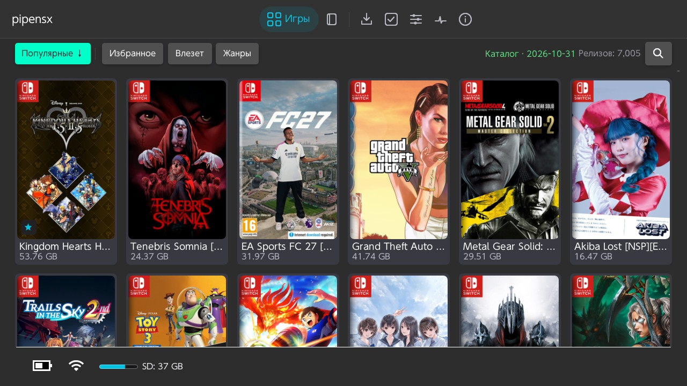
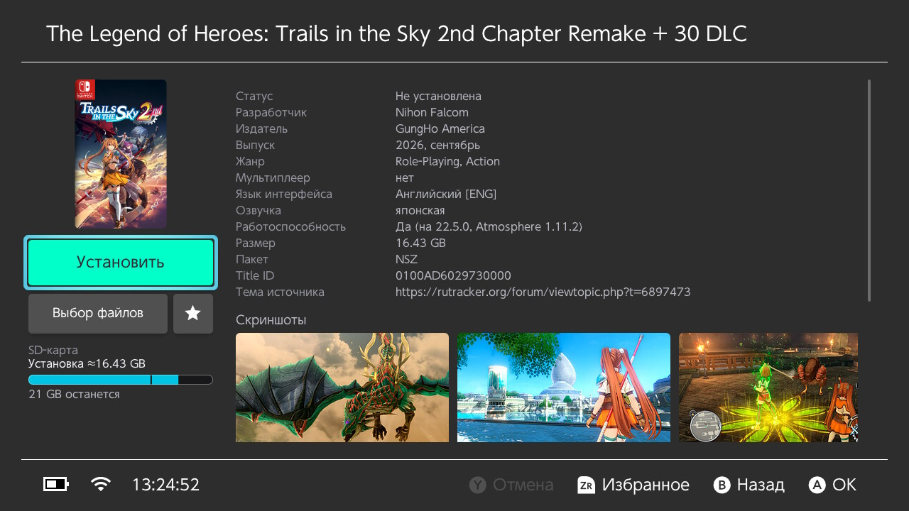
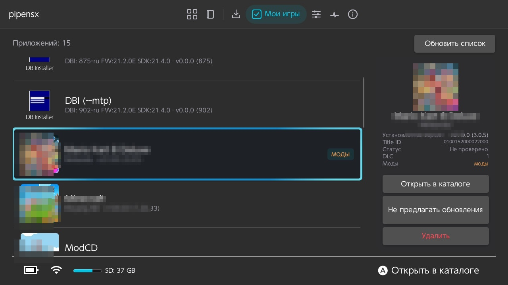

# pipensx

[](https://gitlab.com/pipensx-group/pipensx/-/pipelines)
[](LICENSE)
[](https://gitlab.com/pipensx-group/pipensx/-/releases)

Native BitTorrent download manager and streaming package installer for
Nintendo Switch homebrew.

DOWNLOAD LATEST - [pipensx.nro](https://gitlab.com/pipensx-group/pipensx/-/releases)

 
<br><br>
 


> [!IMPORTANT]
> pipensx does not include Nintendo keys, firmware, games, or a torrent catalog.
> Use it only with content you are legally allowed to download and install. The
> project is not affiliated with Nintendo, RuTracker, or the catalog provider.

> [!NOTE]
> This project was developed with substantial assistance from AI tools for code
> generation, refactoring, testing, review, and documentation. Changes are
> still built and validated before they are merged.

## Features

- native Borealis interface with controller, touch, light/dark, handheld, and
  docked support
- persistent FIFO queue with pause, resume, retry, recheck, and safe shutdown
- redesigned Downloads workspace with live category filters (All, Active, Queued, Finished, Errors)
- refined Installed Games view with direct actions (Open in catalog, Update, Ignore, Uninstall) and facts table
- restart-safe piece verification and download recovery
- tracker, DHT, and PEX peer discovery
- live, cached catalog loaded from the trusted Langegen catalog with cover URLs
- offline magnet resolution when the catalog provides a verified info dictionary
- download-only mode and sequential NSP/NSZ installation while pieces arrive
- unified homebrew-port installs: NRO application folders and ZIP/7z payloads
  are deployed safely to `SD:/switch/` before local NSP/NSZ forwarders install
- Application, Patch, and AddOnContent packages with installed-version checks
- optional debrid fetch via TorBox, Real-Debrid, AllDebrid, or a self-hosted TorrServer
- optional HTTPS/SOCKS proxy for catalog, artwork, and debrid HTTPS traffic
- download diagnostics, speed history, peer state, and extended telemetry

The public build intentionally starts without a bundled catalog. On first use,
the Catalog view refreshes from the trusted Langegen source and then uses its
on-SD cache.

If you wish to use an alternative catalog source, open **Settings → Catalog →
Catalog source** and select **Custom URL**. You can enter any custom HTTPS JSON
URL or return to **Default (Langegen)** at any time. Updating the catalog
includes its cover URLs without a separate artwork update.

## Quick start

Development uses Gitea at `git@192.168.1.146:i3sey/pipensx.git` as the primary
repository. Gitea mirrors branches and tags to
[GitLab](https://gitlab.com/pipensx-group/pipensx) on push and every eight hours.
GitLab hosts releases and the GitLab CI pipeline. Push development changes to
Gitea; see [BUILD.md](BUILD.md#development-remotes) for remote setup.

Clone the pinned submodules:

```bash
git clone --recurse-submodules https://gitlab.com/pipensx-group/pipensx.git
cd pipensx
```

Run the portable PC test suite:

```bash
make test
```

Build the Nintendo Switch application after installing devkitPro dependencies:

```bash
export DEVKITPRO=/opt/devkitpro
make switch
```

The resulting application is `build-switch/pipensx.nro`. See
[BUILD.md](BUILD.md) for dependency installation, optional
metadata input, and deployment helpers.

## Install on Nintendo Switch

Download the latest [pipensx.nro](https://gitlab.com/pipensx-group/pipensx/-/releases) and copy it to:

```text
SD:/switch/pipensx/pipensx.nro
```

Launch it through hbmenu in **application mode** by holding `R` while opening a
game. Album applet mode is rejected because it does not provide enough memory
and network resources for the application.

Runtime data is stored below `SD:/switch/pipensx/`, including:

```text
queue.bencode
torrents/
downloads/
task-files/
deployments/
dht_nodes.bin
catalog/catalog.json
catalog/metadata/
catalog/images/
pipensx.log
```

The interface displays contextual controller hints. The main actions cover
adding torrents, opening details, pausing/resuming, retrying/rechecking, and
safely stopping the active task before exit.

## Ports, mods, and translations

Installing a homebrew port offers **Try automatic install** or **Download only**.
Automatic installation downloads the selected payload, copies or extracts it to
the SD card, and then installs bundled NSP/NSZ forwarders without another
confirmation. Download only leaves the files in the downloads folder.

**Select files** lets you choose **Install**, **Download**, or **Skip** for each
file. Install is available for NSP/NSZ, recognized NRO application files, ZIP/7z
payloads, and supported LayeredFS mods and translations. Installing an NRO also
selects its companion application files; individual choices can then be adjusted.
Applying Install to a folder installs supported files and downloads the rest.
Selected installation actions run automatically after downloading.

When a regular game release includes installable extras, Install offers the
normal recommended game packages without extras, or the manual file selector.
Executable patches remain an explicit choice in the selector. If automatic
deployment fails, the application reports the reason and retains downloaded
files. The web panel remains available for custom destination folders.

## Catalog and network behavior

The application fetches `switch_games.json` over HTTPS from Langegen by
default. The optional pipensx-catalog release channel checks a manifest first
and downloads its catalog only when the SHA-256 changes. Settings let
you point at any other HTTPS URL
that serves the same JSON shape. Redirects are limited to the source file's
directory, except the release-asset hosts of the built-in channel;
look-alike hosts are rejected before catalog bytes are parsed. A
failed refresh leaves the last valid SD-card cache active.

Catalog magnets are resolved from a pre-verified info dictionary when one is
available, otherwise through BitTorrent extension-protocol peers. Received
metadata is checked against the magnet info hash before entering the normal
torrent preview and queue flow.

One to four downloads may run concurrently, while stream installation remains
serialized. Existing files are verified before a task starts or resumes.
Interrupted package streams resume from their last persisted safe point;
packages committed before the interruption remain installed and are skipped.
Runtime behavior such as sleep/wake, long installs, and `/switch` file copying
must ultimately be validated on physical Switch hardware.

## Contributing and security

Read [CONTRIBUTING.md](CONTRIBUTING.md) before sending a change. Report
vulnerabilities privately as described in [SECURITY.md](SECURITY.md); do not
place secrets or copyrighted datasets in issues or fixtures.

Historical implementation notes are archived under
[`docs/plans/`](docs/plans/README.md). They are not the current roadmap.

## License

pipensx is licensed under the GNU General Public License v3.0. See
[LICENSE](LICENSE). Third-party components retain their original licenses as
listed in [THIRD_PARTY_NOTICES.md](THIRD_PARTY_NOTICES.md).
