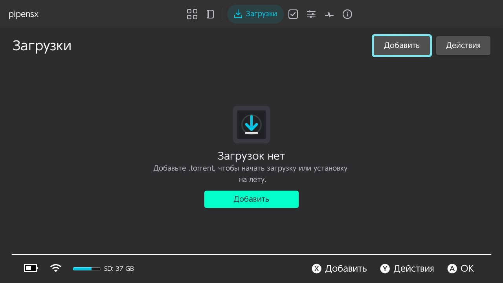

# pipensx

[](https://github.com/i3sey/pipensx/actions/workflows/ci.yml)
[](LICENSE)
[](https://github.com/i3sey/pipensx/releases/latest)

Native BitTorrent download manager and streaming package installer for
Nintendo Switch homebrew.

DOWNLOAD LATEST - [pipensx.nro](https://github.com/i3sey/pipensx/releases/latest/download/pipensx.nro)

 
<br><br>
 


> [!IMPORTANT]
> pipensx does not include Nintendo keys, firmware, games, or a torrent catalog.
> Use it only with content you are legally allowed to download and install. The
> project is not affiliated with Nintendo, RuTracker, or the catalog provider.

> [!NOTE]
> This project was developed with substantial assistance from AI tools for code
> generation, refactoring, testing, review, and documentation. Changes are
> still built and validated before they are merged.

## Features

- native Borealis interface with controller, touch, light/dark, handheld, and
  docked support
- persistent FIFO queue with pause, resume, retry, recheck, and safe shutdown
- redesigned Downloads workspace with live category filters (All, Active, Queued, Finished, Errors)
- refined Installed Games view with direct actions (Open in catalog, Update, Ignore, Uninstall) and facts table
- restart-safe piece verification and download recovery
- tracker, DHT, and PEX peer discovery
- live, cached catalog loaded from the trusted Langegen catalog with cover URLs
- offline magnet resolution when the catalog provides a verified info dictionary
- download-only mode and sequential NSP/NSZ installation while pieces arrive
- unified homebrew-port installs: NRO application folders and ZIP/7z payloads
  are deployed safely to `SD:/switch/` before local NSP/NSZ forwarders install
- Application, Patch, and AddOnContent packages with installed-version checks
- optional debrid fetch via TorBox, Real-Debrid, AllDebrid, or a self-hosted TorrServer
- optional HTTPS/SOCKS proxy for catalog, artwork, and debrid HTTPS traffic
- download diagnostics, speed history, peer state, and extended telemetry

The public build intentionally starts without a bundled catalog. On first use,
the Catalog view refreshes from the trusted Langegen source and then uses its
on-SD cache.

Open **Settings → Catalog → Catalog source** to choose GitHub (global),
GitLab (global), or GitVerse (Russia, marked with the Russian flag). Built-in
mirrors follow the catalog language. If the selected mirror fails or returns
invalid JSON, the app tries the other mirrors and retains the cached catalog
if all fail. The selected preference stays unchanged. **Custom URL** accepts
an HTTPS JSON URL and uses only that source. Updating the catalog includes its
cover URLs without a separate artwork update.

The **Homebrew** tab has a separate app catalog with search, descriptions and
direct NRO/ZIP installation. Downloads are checked against their SHA-256 before
files are written to the SD card. See [Homebrew catalog](docs/HOMEBREW.md) for
file replacement rules and system-module handling.

## Quick start

[GitHub](https://github.com/i3sey/pipensx) is the primary repository hosting
development, CI, issues, pull requests, and releases.
[GitLab](https://gitlab.com/pipensx-group/pipensx) and local Gitea
(`git@192.168.1.146:i3sey/pipensx.git`) are maintained as backup mirrors. See
[BUILD.md](BUILD.md#development-remotes) for remote setup.

Clone the pinned submodules:

```bash
git clone --recurse-submodules https://github.com/i3sey/pipensx.git
cd pipensx
```

Run the portable PC test suite:

```bash
make test
```

Build the Nintendo Switch application after installing devkitPro dependencies:

```bash
export DEVKITPRO=/opt/devkitpro
make switch
```

The resulting application is `build-switch/pipensx.nro`. See
[BUILD.md](BUILD.md) for dependency installation, optional
metadata input, and deployment helpers.

## Install on Nintendo Switch

Download the latest [pipensx.nro](https://github.com/i3sey/pipensx/releases/latest/download/pipensx.nro) and copy it to:

```text
SD:/switch/pipensx/pipensx.nro
```

Launch it through hbmenu in **application mode** by holding `R` while opening a
game. Album applet mode is rejected because it does not provide enough memory
and network resources for the application.

Runtime data is stored below `SD:/switch/pipensx/`, including:

```text
queue.bencode
torrents/
downloads/
task-files/
deployments/
dht_nodes.bin
catalog/catalog.json
catalog/metadata/
catalog/images/
pipensx.log
```

The interface displays contextual controller hints. The main actions cover
adding torrents, opening details, pausing/resuming, retrying/rechecking, and
safely stopping the active task before exit.

## Ports, mods, and translations

Installing a homebrew port offers **Try automatic install** or **Download only**.
Automatic installation downloads the selected payload, copies or extracts it to
the SD card, and then installs bundled NSP/NSZ forwarders without another
confirmation. Download only leaves the files in the downloads folder.

**Select files** lets you choose **Install**, **Download**, or **Skip** for each
file. Install is available for NSP/NSZ, recognized NRO application files, ZIP/7z
payloads, and supported LayeredFS mods and translations. Installing an NRO also
selects its companion application files; individual choices can then be adjusted.
Applying Install to a folder installs supported files and downloads the rest.
Selected installation actions run automatically after downloading.

When a regular game release includes installable extras, Install offers the
normal recommended game packages without extras, or the manual file selector.
Executable patches remain an explicit choice in the selector. If automatic
deployment fails, the application reports the reason and retains downloaded
files. The web panel remains available for custom destination folders.

## Catalog and network behavior

The [web companion](docs/REMOTE_LIBRARY.md) provides queue controls, file selection,
catalog favorites and batch adding, installed-title management, console settings,
storage cleanup, and diagnostics from a phone or computer on the same network.
Maintenance can replace the running NRO with a local file, including an older or
identical version. After applying it, reopen pipensx on the Switch; the browser
reconnects when the application returns. AutoRun is hidden in the web UI.

The application fetches a language-specific catalog over HTTPS from Langegen by
default. It tries GitHub Raw, then the GitHub API, then a stored GitLab mirror
snapshot with size and SHA-256 verification. See
[Catalog mirror](docs/CATALOG_MIRROR.md) for publication and refresh behavior.
The deprecated pipensx-catalog release channel checks a manifest first
and downloads its catalog only when the SHA-256 changes. Settings let
you point at any other HTTPS URL
that serves the same JSON shape. Redirects are limited to the source file's
directory, except the exact fallback resources of Langegen and the
release-asset hosts of the built-in release channel;
look-alike hosts are rejected before catalog bytes are parsed. A
failed refresh leaves the last valid SD-card cache active.

Catalog magnets are resolved from a pre-verified info dictionary when one is
available, otherwise through BitTorrent extension-protocol peers. Received
metadata is checked against the magnet info hash before entering the normal
torrent preview and queue flow.

One to four downloads may run concurrently, while stream installation remains
serialized. Existing files are verified before a task starts or resumes.
Interrupted package streams resume from their last persisted safe point;
packages committed before the interruption remain installed and are skipped.

On **Downloads**, **Blank screen** controls the display only while downloads or
installation are active. Both modes prevent automatic sleep during that work.
When enabled, the screen turns off three seconds after the button is pressed.
Touch, a controller button, or a stick wakes it; the wake input is absorbed until
release, followed by a 300 ms guard. The screen turns off again after seven
seconds of inactivity. The selection survives restarts and leaves normal idle
settings in control when no download or installation is active.

**Settings → Downloads → Sleep after downloads finish** is off by default, so
completed torrents can keep seeding. Enable it to request system sleep after the
whole queue, including installation, finishes successfully. Paused, failed, or
deleted tasks do not trigger sleep. Application mode requires firmware 10.0.0 or
later; applet mode requires 15.0.0 or later. If sleep is unavailable or the request
fails, pipensx reports the failure and keeps running.

In **Settings → Source**, enable **Keep uncached torrents in debrid**
to retain unfinished transfers in your provider account when metadata resolution
times out or you cancel or exit preparation. Pending entries reuse the saved
transfer ID or match an existing TorBox transfer by info-hash on return, prune
automatically after 7 days, and can be inspected or removed from **Settings →
Source → Pending cloud caches**. Cloud caching and any required file selection
follow the provider's rules; the option is off by default.

Runtime behavior such as sleep/wake, long installs, and `/switch` file copying
must ultimately be validated on physical Switch hardware.

## Contributing and security

Read [CONTRIBUTING.md](CONTRIBUTING.md) before sending a change. Report
vulnerabilities privately as described in [SECURITY.md](SECURITY.md); do not
place secrets or copyrighted datasets in issues or fixtures.

Historical implementation notes are archived under
[`docs/plans/`](docs/plans/README.md). They are not the current roadmap.

## License

pipensx is licensed under the GNU General Public License v3.0. See
[LICENSE](LICENSE). Third-party components retain their original licenses as
listed in [THIRD_PARTY_NOTICES.md](THIRD_PARTY_NOTICES.md).
